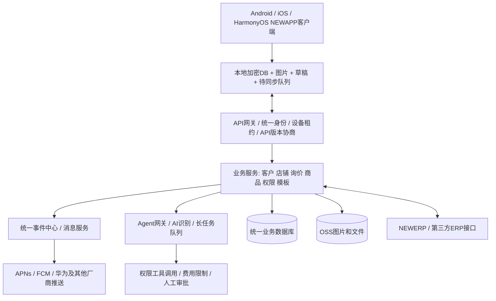
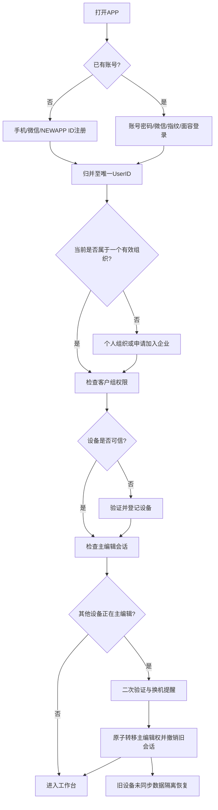
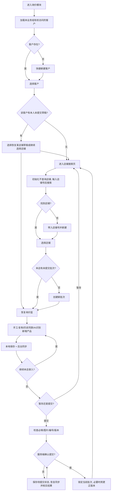
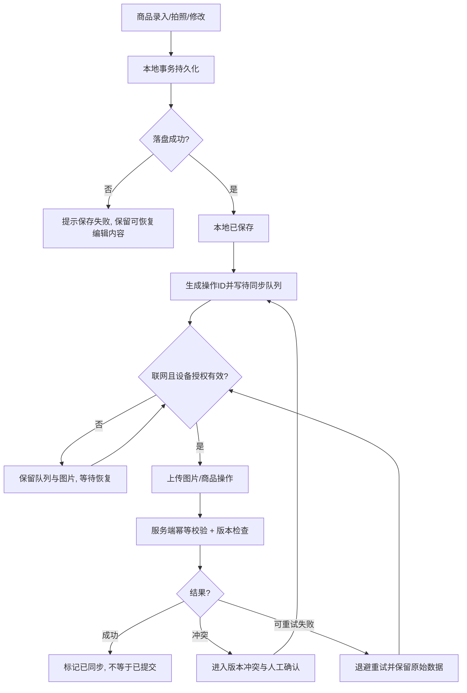
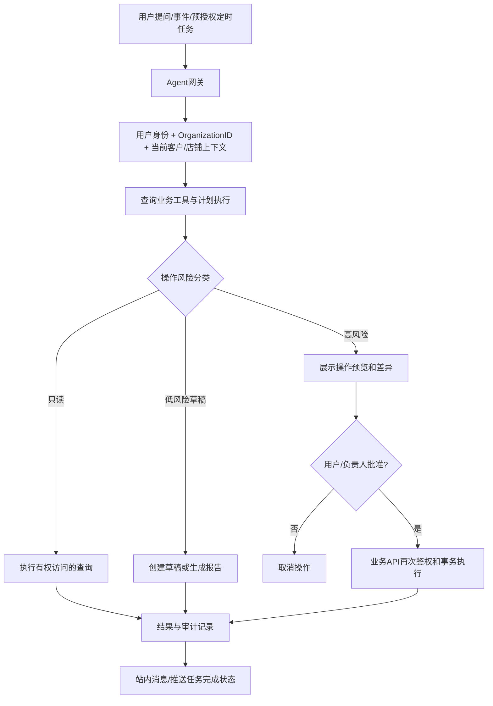
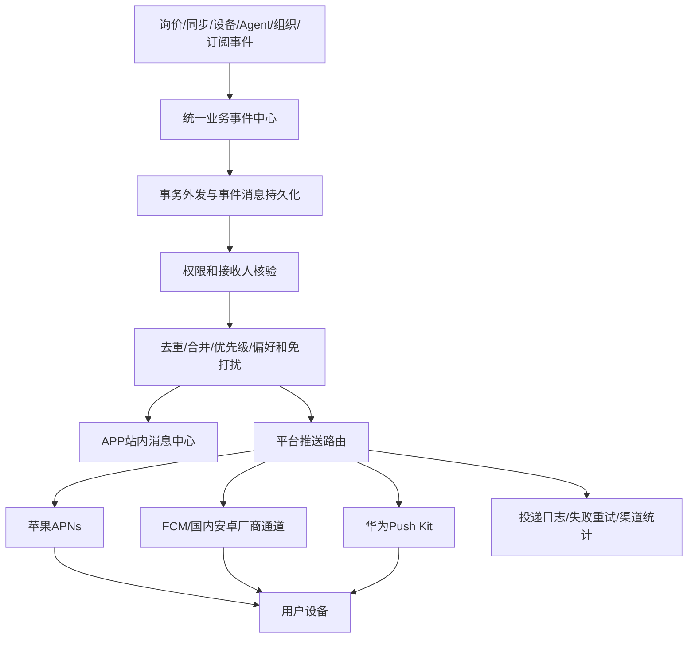
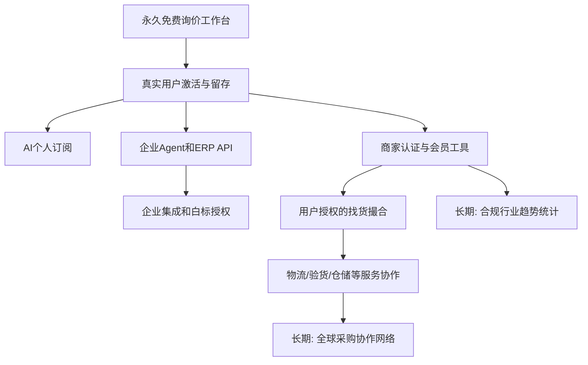

# NEWAPP V4.0 业务架构与流程图（Mermaid 可编辑源码）

日期：2026-10-14

使用方法：在支持 Mermaid 的 Markdown 编辑器中打开，或复制单个 `mermaid` 代码块到 Mermaid Live Editor、VS Code Mermaid 插件中修改。此文件是《NEWAPP V4.0 总体架构、功能模块、业务流程及商业模式》的辅助材料。

## 1. 总体系统架构

## 2. 登录、组织唯一归属和主设备切换

## 3. 询价全流程

## 4. 离线存储与可靠同步

## 5. Agent执行与人机审批

## 6. 消息推送中心

## 7. 商业化拓展路径

## 8. 规划与执行约束

- 基础询价永久免费；AI能力收费不能限制原有业务数据使用与导出。
- 统一UserID，一个有效组织归属；多台可信设备登记，同一时间一个服务端主编辑会话。
- 离线状态下无法即时吊销完全断网设备的本地修改，须由授权有效期及重新同步时的冲突恢复控制。
- 免费用户与商家用户之间的数据共享必须经有效授权；私有客户询价绝不可因商家付费默认公开。
- Agent通过业务工具调用，所有工具必须重新执行服务端权限校验；高风险操作保留人工审批。
- 各平台的登录、支付、更新与推送SDK支持及上架规则需要在开发与发布时再次核验。